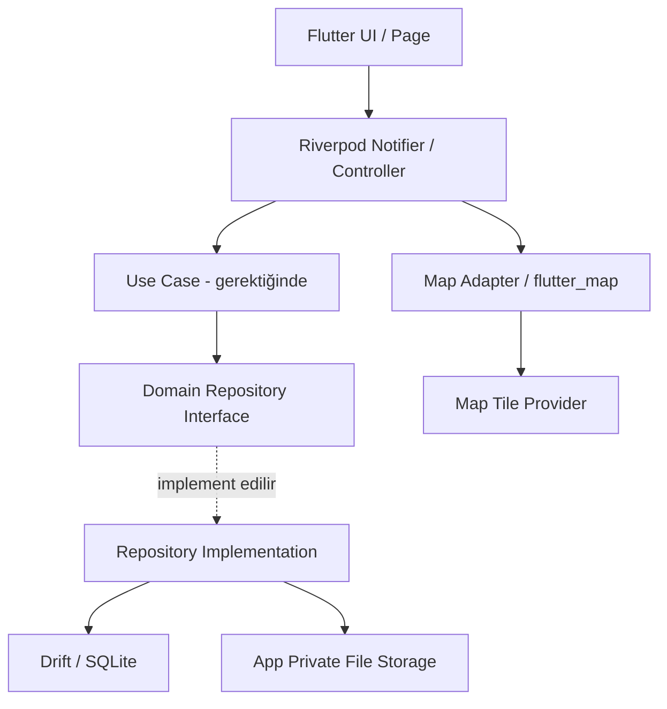
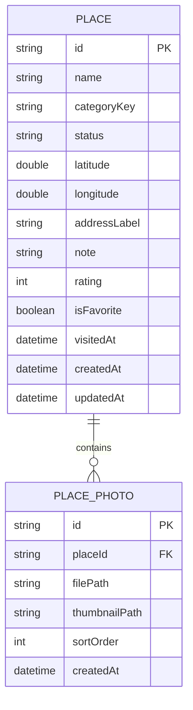

# MekânDefteri — Ürün, Teknik Mimari ve Google Play Yayın Planı

> **Belge türü:** Ürün gereksinimleri + teknik tasarım + geliştirme yol haritası  
> **Sürüm:** 1.0  
> **Hazırlanma tarihi:** 23 Kasım 2026  
> **Hedef platform:** Android (Flutter)  
> **Ürün yaklaşımı:** Ücretsiz, reklamsız, kişisel kullanım odaklı, çevrimdışı öncelikli mobil uygulama

---

## 0. Yönetici özeti

**MekânDefteri**, kullanıcının keşfettiği veya ileride ziyaret etmek istediği mekânları kendi kişisel haritasına kaydetmesini sağlayan dijital bir şehir keşif defteridir. Kullanıcı bir kafe, restoran, kitapçı, sahil, müze veya başka bir noktayı haritada işaretler; fotoğraf, kategori, puan ve kişisel not ekler. Daha sonra kayıtlarını harita veya liste üzerinden arar, filtreler ve favorilerini görüntüler.

Bu proje yalnızca bir harita ekranı değildir. Portföy açısından aşağıdaki yetkinlikleri gösterecek gerçek bir mobil ürün olarak tasarlanır:

- Flutter ile çok ekranlı, uyumlu ve erişilebilir mobil arayüz geliştirme.
- Feature-first ve katmanlı mimariyle sürdürülebilir kod organizasyonu.
- SQLite/Drift ile ilişkisel yerel veri saklama ve migration yönetimi.
- Harita üzerinde koordinat gösterme, pin seçme ve konum izni yönetimi.
- Fotoğraf seçme, uygulama alanına kopyalama ve görsel optimizasyonu.
- Arama, filtreleme, sıralama ve boş/hata durumları.
- Birim, widget ve entegrasyon testleri.
- Android release build, imzalama, Play Console kapalı test ve mağaza yayını.

### Ürün için alınan temel kararlar

| Alan | Karar | Gerekçe |
|---|---|---|
| Platform | İlk sürüm Android | Google Play'de gerçek yayın deneyimi hedefleniyor. |
| Framework | Flutter + Dart | Tek kod tabanıyla kaliteli mobil UI ve portföy değeri. |
| Veri saklama | Cihaz içi SQLite | İlk sürümde backend, sunucu ve hesap zorunluluğu yok. |
| Mimari | Feature-first + sade Clean Architecture | Test edilebilirlik sağlar; küçük projeyi gereksiz soyutlamayla boğmaz. |
| State management | Riverpod | Ekran durumlarını ve bağımlılıkları yönetmek için. |
| Navigasyon | GoRouter | Açık ve test edilebilir sayfa yönlendirmesi. |
| Harita | `flutter_map` + uygun bir OpenStreetMap tabanlı tile sağlayıcısı | Harita sağlayıcısını ileride değiştirebilmek için. |
| Görsel saklama | Uygulamanın özel dosya alanı | Fotoğrafları geçici galeri URI'larına bağımlı bırakmamak için. |
| Hesap sistemi | MVP'de yok | Kullanıcı verileri cihazda kalır; kimlik doğrulama ve hesap silme akışı gereksizleşir. |
| Reklam / gelir | Yok | Uygulama portföy ve deneyim amacıyla ücretsiz yayımlanır. |
| Bulut eşitleme | MVP dışında | Önce temel ürünün sağlam çalışması hedeflenir. |

**Önemli ürün notu:** Harita döşemeleri internet üzerinden gelir. Bu nedenle uygulamanın kayıtları cihazda çevrimdışı kullanılabilir; ancak harita altlığının görüntülenmesi internet bağlantısına ve seçilen harita sağlayıcısının erişilebilirliğine bağlıdır.

---

# 1. Ürün tanımı ve hedef

## 1.1 Problem

İnsanlar beğendikleri mekânları çoğu zaman farklı yerlerde saklar: harita uygulamalarında yıldızlar, Instagram kayıtları, ekran görüntüleri, notlar veya mesajlar. Bir süre sonra neden kaydettiklerini, mekân hakkında ne düşündüklerini veya hangi yerleri henüz ziyaret etmediklerini hatırlamak zorlaşır.

MekânDefteri bu dağınıklığı kişisel, görsel ve harita tabanlı tek bir koleksiyonda birleştirir.

## 1.2 Değer önerisi

**“Gezdiğin yerler kaybolmasın; kendi şehir hikâyeni haritanda biriktir.”**

Uygulama genel bir mekân arama motoru veya sosyal ağ değildir. Kullanıcının kendi seçtiği mekânları kaydettiği özel bir defterdir.

## 1.3 Hedef kullanıcılar

- Yeni kafeler, restoranlar, kitapçılar ve etkinlik alanları keşfetmeyi sevenler.
- Seyahat ettiği şehirlerde ziyaret ettiği yerleri arşivlemek isteyenler.
- Gitmek istediği mekânları unutmamak için kişisel liste tutanlar.
- Fotoğraf ve kısa notlarla küçük bir gezi günlüğü oluşturmak isteyenler.

## 1.4 MVP başarı ölçütleri

İlk sürüm için başarı “çok indirilme” olarak tanımlanmaz. Öncelik, uygulamanın gerçek kullanımda güvenilir ve tamamlanmış hissettirmesidir.

- Kullanıcı yeni bir mekânı 1 dakikadan kısa sürede kaydedebilmeli.
- Kaydedilen mekân uygulama kapatılıp açıldığında kaybolmamalı.
- Aynı kayıt hem haritada hem listede görünmeli.
- Kullanıcı mekânı düzenleyebilmeli ve silebilmeli.
- Arama ve filtreleme sonuçları doğru olmalı.
- Konum izni verilmediğinde uygulama çökmemeli; manuel pin seçimi çalışmalı.
- Fotoğraf izni/erişimi reddedilse de fotoğrafsız kayıt yapılabilmeli.
- Uygulama kritik çökme olmadan temel kullanıcı akışlarını tamamlamalı.

## 1.5 MVP dışında kalan ürün fikirleri

Aşağıdakiler ilk sürümün kapsamını büyütmemek için özellikle ertelenir:

- Kullanıcı hesabı, sosyal profil ve arkadaş ekleme.
- Herkese açık mekân akışı, yorumlar ve topluluk puanları.
- Başka kullanıcıların koleksiyonlarını takip etme.
- AI ile mekân önerisi veya fotoğraftan mekân tanıma.
- Otomatik işletme bilgisi, çalışma saati ve telefon numarası çekme.
- Rota optimizasyonu ve çok duraklı navigasyon.
- Şehir/ülke haritasını çevrimdışı indirme.
- Bulut eşitleme ve cihazlar arası senkronizasyon.
- Abonelik, ödeme ve reklam.

Bu özellikler gelecekte değerlendirilebilir; MVP'de yapılmaması proje eksiği değil, bilinçli kapsam kontrolüdür.

---

# 2. Kullanıcı senaryoları ve temel akışlar

## 2.1 Temel kullanıcı senaryoları

### Senaryo A — Ziyaret edilen mekânı kaydetme

1. Kullanıcı uygulamayı açar.
2. Harita ekranında `+` düğmesine dokunur.
3. Haritada mekânın konumuna dokunur veya haritayı sürükleyip pin konumunu belirler.
4. Mekân adı ve kategori girer.
5. Durumu `Gezildi` olarak seçer.
6. İsteğe bağlı fotoğraf, puan ve not ekler.
7. Kaydeder.
8. Mekân hem haritada pin olarak hem koleksiyon listesinde görünür.

### Senaryo B — İleride gidilecek mekânı kaydetme

1. Kullanıcı `+` düğmesine basar.
2. Haritada bir nokta seçer.
3. Mekân adı ve kategoriyi girer.
4. Durumu `Gitmek istiyorum` olarak seçer.
5. İsteğe bağlı kısa not ekler (ör. “Arkadaşımla git”).
6. Kaydeder.
7. Kayıt `İstek Listem` ekranında listelenir.

### Senaryo C — Kayıt bulma

1. Kullanıcı koleksiyon ekranına geçer.
2. Arama alanına mekân adını yazar.
3. İsterse kategori, durum veya favori filtresi ekler.
4. Sonuçtan mekân detayına gider.
5. Detaydan düzenleme veya silme işlemi yapar.

### Senaryo D — Kullanıcının konumunu haritada gösterme

1. Kullanıcı haritadaki `Konumum` düğmesine basar.
2. Uygulama o anda konum izni ister.
3. İzin verilirse mevcut konum haritanın merkezine alınır.
4. İzin reddedilirse açıklayıcı mesaj gösterilir; manuel harita kullanımı devam eder.

**Kural:** Konum izni uygulama açılır açılmaz istenmez. İzin, yalnızca kullanıcı ilgili özelliği seçtiğinde istenir. Arka plan konumu kullanılmaz.

---

# 3. MVP kapsamı

## 3.1 MVP ekran listesi

| Ekran | Amaç | Öncelik |
|---|---|---|
| İlk açılış / kısa onboarding | Uygulamanın ne yaptığını ve verinin cihazda tutulduğunu anlatmak | P0 |
| Ana harita | Kayıtlı mekân pinlerini göstermek ve yeni konum seçmek | P0 |
| Koleksiyon listesi | Tüm mekânları kart/listede görüntülemek | P0 |
| Mekân ekle / düzenle | Mekân bilgilerini oluşturmak ve güncellemek | P0 |
| Mekân detayı | Fotoğraf, not, kategori, puan ve konumu göstermek | P0 |
| İstek listesi | Henüz ziyaret edilmemiş kayıtları göstermek | P0 |
| Ayarlar / Hakkında | Tema, gizlilik, uygulama sürümü ve veri saklama bilgisi | P0 |

Alt gezinme önerisi:

- **Harita**
- **Koleksiyon**
- **İstek Listem**

Yeni kayıt işlemi harita ve koleksiyon ekranlarında erişilebilir bir `+` aksiyonuyla açılır. Ayarlar, üst köşedeki profil/ayar ikonu üzerinden açılabilir.

## 3.2 MVP fonksiyonları

### Mekân kaydı

- [ ] Mekân adı zorunlu.
- [ ] Harita koordinatı zorunlu.
- [ ] Kategori zorunlu; varsayılan kategori seçilebilir.
- [ ] Durum: `Gezildi` veya `Gitmek istiyorum`.
- [ ] Not alanı isteğe bağlı.
- [ ] 1–5 arası puan isteğe bağlı; yalnızca `Gezildi` kayıtlarında gösterilebilir.
- [ ] Favori işaretleme.
- [ ] Oluşturulma ve güncellenme zamanını kaydetme.
- [ ] Formdan çıkarken kaydedilmemiş değişiklik varsa kullanıcıyı uyarma.

### Varsayılan kategoriler

- Kafe
- Restoran
- Kitapçı
- Doğa / Park
- Müze / Kültür
- Alışveriş
- Sahil / Manzara
- Diğer

MVP'de kategori ekleme/silme zorunlu değildir. Kategoriler sabit bir model/enum olarak başlayabilir. Kullanıcı tanımlı kategoriler sonraki sürüme bırakılır.

### Fotoğraf

- [ ] Sistem fotoğraf seçicisi üzerinden fotoğraf seçme.
- [ ] İlk sürümde en fazla 5 fotoğraf / mekân.
- [ ] Fotoğrafları uygulamanın özel dosya alanına kopyalama.
- [ ] Görselleri uygun boyuta sıkıştırma ve küçük önizleme üretme.
- [ ] Fotoğraf silindiğinde dosyayı da güvenli şekilde kaldırma.
- [ ] Fotoğraf seçimi başarısız olursa kullanıcıya hata gösterme; fotoğrafsız kayıt devam edebilmeli.

### Harita

- [ ] Harita üzerinde kayıtlı mekânları pin olarak gösterme.
- [ ] Pine dokununca kısa mekân kartı / alt panel açma.
- [ ] Haritaya dokunarak yeni pin konumu belirleme.
- [ ] Haritayı seçilen koordinata merkezleme.
- [ ] `Konumum` aksiyonu ve çalışma anında izin isteme.
- [ ] Harita sağlayıcısının lisans atfını görünür gösterme.
- [ ] Harita tile isteği başarısızsa kayıtlı listeye erişimi sürdürme.

### Koleksiyon, arama ve filtreler

- [ ] Tüm mekânları listeleme.
- [ ] Mekân adına göre arama.
- [ ] Kategoriye göre filtreleme.
- [ ] Duruma göre filtreleme.
- [ ] Favorilere göre filtreleme.
- [ ] Son eklenen / ada göre sıralama.
- [ ] Filtre temizleme.
- [ ] Boş sonuç ekranı.

### CRUD işlemleri

- [ ] Create: yeni mekân ekleme.
- [ ] Read: detay ve listeleme.
- [ ] Update: mevcut mekânı düzenleme.
- [ ] Delete: silmeden önce onay; ilişkili fotoğraf dosyalarını da temizleme.

### Ayarlar ve şeffaflık

- [ ] Uygulama adı, sürüm ve geliştirici iletişim bilgisi.
- [ ] Gizlilik politikası bağlantısı.
- [ ] Verilerin ilk sürümde cihazda tutulduğunu açıklayan metin.
- [ ] Uygulama silinirse yerel kayıtların kaybolabileceğini açıklama.
- [ ] Konumun yalnızca kullanıcı isteğiyle kullanıldığını açıklama.
- [ ] Koyu/açık tema tercihi (MVP'de sistem teması + açık/koyu seçimi önerilir).

## 3.3 MVP için önerilen kapsam sınırı

MVP, uygulamanın uçtan uca şu işini kusursuz yapmalıdır:

**Konum seç → mekân bilgisi gir → kaydet → haritada/listede gör → ara/filtrele → düzenle veya sil.**

Bu akış tamamlanmadan gelişmiş animasyon, AI, bulut eşitleme veya özel kategori sistemi eklenmemelidir.

## 3.4 Sürüm planı

| Sürüm | Kapsam |
|---|---|
| 0.1.0 | Proje kurulumu, tema, navigasyon, boş ekranlar |
| 0.2.0 | Yerel veritabanı ve mekân CRUD |
| 0.3.0 | Harita, pinler ve konum seçimi |
| 0.4.0 | Fotoğraflar, detay sayfası, arama ve filtreler |
| 0.5.0 | Hata/boş durumlar, erişilebilirlik, testler ve performans |
| 0.9.0 | İç test / kapalı test adayı |
| 1.0.0 | Google Play ilk genel sürümü |
| 1.1.0 | Yedekleme/dışa aktarma, özel kategoriler veya küçük kullanıcı geri bildirimleri |
| 1.2.0+ | İhtiyaca göre bulut senkronizasyonu, paylaşım veya AI özellikleri |

---

# 4. UX / UI tasarım yönü

## 4.1 Görsel kimlik

**Önerilen stil:** Modern, premium, sıcak ve minimalist. Harita uygulamalarının teknik görünümünü kişisel gezi defteri hissiyle birleştir.

Önerilen tasarım özellikleri:

- Açık krem / kırık beyaz arka plan.
- Koyu kömür grisi metin.
- Vurgu rengi olarak adaçayı yeşili veya derin zeytin tonu.
- Kartlarda yumuşak köşeler ve ölçülü gölge.
- Büyük, temiz başlıklar; küçük ama okunabilir ikincil bilgiler.
- Fotoğraf varsa mekân kartlarında fotoğrafı öne çıkaran düzen.
- Harita ekranında gereksiz kontrollerden kaçınma.
- Material 3 bileşenleri tasarım sistemine uygun biçimde özelleştirme.

Renkler kodlanmadan önce Figma'da gerçek cihaz ekranlarında denenmelidir. Kontrast oranları erişilebilirliği bozacak seviyede düşürülmemelidir.

## 4.2 Ekran davranışları

### Ana harita

- Üstte uygulama adı ve arama ikonu/alanı.
- Haritanın büyük kısmı ekranı kaplar.
- Sağ altta `Konumum` ve `+` aksiyonları.
- Pine dokununca alttan açılan mini mekân kartı.
- Harita ve liste görünümü arasında geçiş yapılabilir; ilk sürümde alt navigasyon yeterli olabilir.
- Haritada çok fazla pin olduğunda performans kontrol edilmeli; ilk sürümde clustering zorunlu değil.

### Koleksiyon

- Başlık: “Mekânlarım”.
- Arama alanı.
- Yatay kategori filtre çipleri.
- Durum/favori filtreleri.
- Fotoğraflı veya ikincil bilgili liste kartları.
- Kayıt yoksa “İlk keşfini ekle” çağrısı.

### Mekân detay

- Üstte fotoğraf galerisi.
- Mekân adı, kategori rozeti ve favori düğmesi.
- Puan, durum ve ziyaret tarihi.
- Not alanı.
- Haritada göster aksiyonu.
- Düzenle ve sil aksiyonları.

### Mekân ekleme/düzenleme

Form alanları tek ekranda veya iki adımlı akışta sunulabilir:

1. Konum seç.
2. Mekân adı, kategori ve durum gir.
3. İsteğe bağlı fotoğraf, puan ve not gir.
4. Kaydet.

Form hata mesajları alanın hemen yakınında gösterilmeli. Kullanıcının yazdığı metin form hatasında kaybolmamalı.

## 4.3 Erişilebilirlik ve kullanılabilirlik

- Dokunma hedefleri rahat kullanılabilir boyutta olmalı.
- Ekran okuyucular için ikonlara anlamlı semantic label verilmeli.
- Renk, tek başına durum anlatmak için kullanılmamalı; metin/ikon ile desteklenmeli.
- Dinamik yazı boyutlarında taşma kontrol edilmeli.
- Harita pinlerinin seçilebilir alanları yeterli olmalı.
- İnternet yok, konum izni yok, fotoğraf izni yok ve boş liste durumları tasarlanmalı.

---

# 5. Teknik mimari

## 5.1 Mimari yaklaşım

Öneri: **Feature-first + katmanlı Clean Architecture'ın sadeleştirilmiş uygulaması.**

Her özellik kendi klasöründe tutulur. UI katmanı veri kaynağına doğrudan erişmez; Repository arayüzü üzerinden işlem yapar. İş mantığı ViewModel/Notifier ve gerektiğinde UseCase sınıflarında bulunur.

Küçük bir uygulamada her metot için ayrı UseCase oluşturmak zorunlu değildir. İş akışı karmaşıklaştığında UseCase eklenir. Amaç mimariyi göstermek için gereksiz dosya üretmek değil; değişikliği kontrollü hâle getirmektir.

### Katman sorumlulukları

| Katman | Sorumluluk | Örnek |
|---|---|---|
| Presentation | Ekranlar, widget'lar, kullanıcı etkileşimi, UI state | `PlacesMapPage`, `PlaceFormPage` |
| Application | Ekran mantığı, state yönetimi, validasyon akışları | `PlacesNotifier`, `PlaceFormController` |
| Domain | İş kuralları, entity ve repository sözleşmeleri | `Place`, `PlaceRepository` |
| Data | SQLite, dosya sistemi, mapper ve repository implementasyonu | `PlaceLocalDataSource`, `PlaceRepositoryImpl` |
| Core | Ortak tema, hata tipleri, router, yardımcı servisler | `AppTheme`, `AppRouter` |

### Veri akışı



## 5.2 Önerilen teknoloji listesi

> Paketlerin sürümleri geliştirmeye başlanırken pub.dev ve Flutter stable sürümü üzerinden kontrol edilmeli; bu belgede bilerek sabit sürüm numarası verilmemiştir.

| Teknoloji / Paket | Kullanım | Not |
|---|---|---|
| Flutter / Dart | Mobil uygulama | Stable kanal tercih edilmeli. |
| Riverpod | State management ve dependency injection | `flutter_riverpod`; code generation zorunlu değil. |
| GoRouter | Navigasyon | Named route ve deep link ihtiyacına açık yapı. |
| Drift + SQLite | Yerel ilişkisel veritabanı | Migration ve sorgu yönetimi. |
| flutter_map | Harita widget'ı | Tile sağlayıcısı ve atıf görünür olmalı. |
| latlong2 | Koordinat modelleri | Harita koordinat işlemleri. |
| geolocator | Kullanıcı konumu | Yalnızca “Konumum” aksiyonunda izin iste. |
| image_picker | Sistem fotoğraf seçicisi | Geniş galeri izni istemekten kaçın. |
| path_provider | Uygulama dosya dizini | Fotoğrafları özel alana kopyala. |
| image | Görsel yeniden boyutlandırma / sıkıştırma | İşlemi mümkünse UI thread dışında yürüt. |
| uuid | Yerel kayıt kimliği | UUID ile cihaz içi çakışma riskini azalt. |
| intl | Tarih ve sayı biçimleme | Türkçe tarih biçimleri. |
| url_launcher | Gizlilik politikası / harici bağlantı | Yalnızca gerekli bağlantılar. |
| flutter_lints | Kod standartları | CI ve geliştirme aşamasında çalıştır. |
| mocktail veya mockito | Test double | Tek bir mocking kütüphanesi seç. |

**Not:** Firebase/Supabase MVP için gerekli değildir. Yerel öncelikli üründe sırf teknoloji listesi kalabalık görünsün diye backend eklemek, geliştirme ve gizlilik yükünü artırır.

## 5.3 Önerilen proje klasör yapısı

```text
lib/
├── main.dart
├── app/
│   ├── app.dart
│   ├── router/
│   │   └── app_router.dart
│   └── providers.dart
│
├── core/
│   ├── constants/
│   │   ├── app_constants.dart
│   │   └── place_categories.dart
│   ├── database/
│   │   ├── app_database.dart
│   │   ├── tables/
│   │   └── migrations/
│   ├── errors/
│   │   ├── app_exception.dart
│   │   └── failure.dart
│   ├── theme/
│   │   ├── app_theme.dart
│   │   ├── app_colors.dart
│   │   └── app_typography.dart
│   ├── utils/
│   │   ├── date_formatters.dart
│   │   └── validators.dart
│   └── widgets/
│       ├── app_empty_state.dart
│       ├── app_error_view.dart
│       └── app_loading_view.dart
│
├── features/
│   ├── places/
│   │   ├── data/
│   │   │   ├── datasources/
│   │   │   │   ├── place_local_data_source.dart
│   │   │   │   └── place_photo_storage.dart
│   │   │   ├── models/
│   │   │   │   └── place_dto.dart
│   │   │   └── repositories/
│   │   │       └── place_repository_impl.dart
│   │   ├── domain/
│   │   │   ├── entities/
│   │   │   │   ├── place.dart
│   │   │   │   └── place_photo.dart
│   │   │   └── repositories/
│   │   │       └── place_repository.dart
│   │   └── presentation/
│   │       ├── controllers/
│   │       ├── pages/
│   │       │   ├── places_map_page.dart
│   │       │   ├── places_list_page.dart
│   │       │   ├── place_detail_page.dart
│   │       │   └── place_form_page.dart
│   │       └── widgets/
│   │           ├── place_card.dart
│   │           ├── place_marker.dart
│   │           ├── place_filter_bar.dart
│   │           └── place_photo_gallery.dart
│   │
│   ├── wishlist/
│   │   └── presentation/
│   │       ├── pages/
│   │       └── widgets/
│   │
│   ├── settings/
│   │   └── presentation/
│   │       ├── pages/
│   │       └── controllers/
│   │
│   └── onboarding/
│       └── presentation/
│           ├── pages/
│           └── controllers/
│
└── l10n/
    └── app_tr.arb

test/
├── unit/
│   ├── domain/
│   ├── data/
│   └── controllers/
├── widget/
└── integration/
```

Bu yapı ilk commit'te bütün dosyaları boş yere oluşturarak değil, özellikler geliştikçe genişletilmelidir.

---

# 6. Veri modeli ve yerel veritabanı

## 6.1 Ana veri nesneleri

### Place

Bir mekânın tüm temel bilgilerini temsil eder.

| Alan | Tip | Zorunlu | Açıklama |
|---|---|---:|---|
| `id` | String / UUID | Evet | Birincil anahtar. |
| `name` | String | Evet | Mekân adı; boş olamaz. |
| `categoryKey` | String | Evet | Sabit kategori anahtarı. |
| `status` | String / enum | Evet | `visited` veya `planned`. |
| `latitude` | double | Evet | Enlem. |
| `longitude` | double | Evet | Boylam. |
| `addressLabel` | String? | Hayır | Kullanıcının girdiği kısa adres/açıklama. |
| `note` | String? | Hayır | Kişisel not. |
| `rating` | int? | Hayır | 1–5; yalnızca gezilmiş mekâna uygulanır. |
| `isFavorite` | bool | Evet | Varsayılan false. |
| `visitedAt` | DateTime? | Hayır | Ziyaret tarihi. |
| `createdAt` | DateTime | Evet | Oluşturulma zamanı. |
| `updatedAt` | DateTime | Evet | Son düzenleme zamanı. |

### PlacePhoto

Fotoğrafları `Place` tablosundan ayrı saklamak daha esnektir.

| Alan | Tip | Zorunlu | Açıklama |
|---|---|---:|---|
| `id` | String / UUID | Evet | Birincil anahtar. |
| `placeId` | String / UUID | Evet | Place foreign key. |
| `filePath` | String | Evet | Uygulama özel alanındaki orijinal/sıkıştırılmış görsel yolu. |
| `thumbnailPath` | String? | Hayır | Küçük liste görseli. |
| `caption` | String? | Hayır | Fotoğraf açıklaması; sonraki sürüme bırakılabilir. |
| `sortOrder` | int | Evet | Galeri sırası. |
| `createdAt` | DateTime | Evet | Eklenme zamanı. |

### AppPreference

Kullanıcı tercihlerinin yerel saklanması için.

| Alan | Tip | Açıklama |
|---|---|---|
| `key` | String | Tercih anahtarı. |
| `value` | String | Tema tercihi, onboarding durumu vb. |

## 6.2 İlişkiler



## 6.3 Veritabanı kuralları

- `Place.id` birincil anahtar olmalı.
- `PlacePhoto.placeId`, `Place.id` alanına foreign key ile bağlanmalı.
- Bir mekân silindiğinde fotoğraf kayıtları da veritabanından silinmeli (`ON DELETE CASCADE`).
- Dosya sistemi ve veritabanı tek bir transaction değildir. Bu nedenle mekân silme akışı önce ilişkili dosya yollarını toplamalı, veritabanı kaydını transaction içinde silmeli, ardından dosyaları güvenli şekilde temizlemelidir. Dosya silme başarısız olursa artık kullanılmayan dosyaları temizleyecek bir bakım kontrolü bulunmalıdır.
- Puan yalnızca 1–5 arasında olmalı.
- Enlem `-90..90`, boylam `-180..180` aralığında olmalı.
- `name.trim()` boş ise kayıt engellenmeli.
- `visited` durumunda ziyaret tarihi isteğe bağlı olabilir; kullanıcı tarih seçmezse kayıt zamanı varsayılan alınabilir.
- `planned` durumuna geçildiğinde puan ve ziyaret tarihi temizlenmeli veya UI'da etkisiz hâle gelmeli.
- Veritabanı şema sürümü takip edilmeli; değişiklikler migration ile yapılmalı.

## 6.4 Örnek sorgular

- Tüm mekânları son eklenene göre listele.
- `status = planned` olanları getir.
- `isFavorite = true` olanları getir.
- `categoryKey` eşleşenleri getir.
- `name` alanında arama metni geçen kayıtları getir.
- Harita görünüm sınırları (visible bounds) içinde kalan koordinatları getir.

Arama ve filtreler mümkün olduğunca SQLite sorgusunda yapılmalı; tüm kayıtları belleğe çekip büyük koleksiyonları UI tarafında filtrelemekten kaçınılmalıdır.

---

# 7. Harita, konum ve dış servis yaklaşımı

## 7.1 Harita sağlayıcısı

İlk teknik prototip için `flutter_map` değerlendirilebilir. Harita altlığı için OpenStreetMap verisini kullanan uygun bir tile hizmeti seçilir. Harita kütüphanesi ile tile sağlayıcısı aynı şey değildir: `flutter_map` haritayı çizer; tile sağlayıcısı harita görsellerini sunar.

**Üretim için önemli:** `tile.openstreetmap.org` ücretsiz veri sunar ancak sunucu altyapısı sınırsız ve garantili ücretsiz bir uygulama API'si değildir. Doğrudan standart OSM tile sunucusu kullanılacaksa güncel Tile Usage Policy'ye uyulmalıdır:

- Harita üzerinde görünür `© OpenStreetMap contributors` atfı bulunmalı.
- Uygulamayı tanımlayan geçerli ve sabit User-Agent kullanılmalı.
- Sunucunun cache başlıklarına uyulmalı; yeniden indirmeler gereksiz yere tekrarlanmamalı.
- Tile'lar toplu biçimde önceden indirilemez; standart OSM tile servisiyle çevrimdışı harita indirme özelliği sunulamaz.
- Tile URL'si kodun farklı noktalarına sabit gömülmemeli; yapılandırılabilir olmalı.

Resmî politika: https://operations.osmfoundation.org/policies/tiles/

**Önerilen uygulama kararı:** Tile sağlayıcı bilgisi tek bir `MapTileConfig`/adapter içinde tanımlansın. Geliştirme ve test sırasında uygun test katmanı kullanılabilir; Play Store sürümünde ise sağlayıcının kullanım koşulları, trafik sınırları, kimlik doğrulama gereksinimi ve fiyatlandırması kontrol edilmiş olsun. Gerekirse OSM tabanlı ticari bir sağlayıcı seçilsin. API anahtarları kaynak koda yazılmasın; güvenli build yapılandırması kullanılsın.

## 7.2 Mekân konumu nasıl belirlenecek?

MVP'de işletme arama/geocoding servisi zorunlu değildir. Kullanıcı haritada istediği yere dokunarak pin'i manuel yerleştirir. Böylece:

- API anahtarı ve ücretli Places servisi zorunlu olmaz.
- Geocoding kotası ve veri doğruluğu sorunları ilk sürüme taşınmaz.
- Kullanıcı tam işletme girişini bulamasa bile yaklaşık konum kaydedebilir.

İleride adres arama eklenirse Nominatim gibi servislerin kullanım koşulları ayrıca incelenmelidir. Genel amaçlı ücretsiz bir servisin yoğun uygulama trafiği için sınırsız kullanılabileceği varsayılmamalıdır.

## 7.3 Konum izni

- Uygulama başlangıcında izin isteme.
- Kullanıcı `Konumum` düğmesine basınca izin akışını başlat.
- Reddedilirse manuel harita kullanımı çalışmaya devam etmeli.
- Kalıcı olarak reddedilmişse sistem ayarlarına gitme seçeneği gösterilebilir.
- Arka plan konumu isteme.
- İlk sürümde yaklaşık konum yeterli olabilir; hassasiyet tercihi gerçekten ihtiyaçla orantılı olmalı.

## 7.4 Harita hata senaryoları

- İnternet yok: Harita altlığı yüklenemeyebilir; kullanıcı kayıt listesine erişebilmeli.
- Tile sunucusu cevap vermiyor: Haritada tekrar dene/hata göstergesi olmalı; uygulama çökmeden devam etmeli.
- Konum izni yok: Varsayılan şehir/son harita merkezi gösterilmeli.
- Koordinat kaydı bozuk: Veritabanı doğrulaması geçersiz koordinatı engellemeli.
- Çok fazla pin: Gerektiğinde harita marker clustering sonraki sürümde eklenmeli.

---

# 8. Fotoğraf ve dosya yönetimi

## 8.1 Fotoğraf ekleme akışı

1. Kullanıcı galeri/fotoğraf ekle aksiyonuna basar.
2. Android sistem fotoğraf seçicisi açılır.
3. Seçilen görsel geçici URI/path olarak alınır.
4. Görsel uygulamanın özel dosya alanına kopyalanır.
5. Gerekirse boyutu ve kalite seviyesi optimize edilir.
6. Küçük önizleme/thumbnail oluşturulur.
7. Dosya yolları `PlacePhoto` tablosuna kaydedilir.
8. UI güncellenir.

## 8.2 Dosya yönetimi kuralları

- Kullanıcı fotoğrafının orijinal dosya yoluna kalıcı bağımlılık kurulmaz; uygulama kendi kopyasını saklar.
- Görseller gereksiz yere tam çözünürlükte tutulmamalı; fotoğraf kalitesi ile depolama arasında makul denge kurulmalı.
- Liste görünümünde thumbnail kullanılmalı.
- Fotoğraf dosya adları UUID ile oluşturulmalı.
- Kullanıcı fotoğraf silerse hem DB satırı hem dosya temizlenmeli.
- Bozuk veya bulunamayan fotoğraf yolu UI'da placeholder göstermeli; ekran çökmesine neden olmamalı.
- EXIF metadata (özellikle fotoğrafın GPS bilgisini) varsayılan olarak ayrıca çıkarıp saklama. Konum yalnızca kullanıcı pin seçtiğinde kaydedilsin.

## 8.3 Depolama sınırı

İlk sürümde uygulama başına fotoğraf sayısı 5 ile sınırlandırılabilir. Dosya boyutu ve çözünürlük sınırları gerçek cihaz testlerinden sonra netleştirilir. Bu sınırlar kullanıcıya açıkça belirtilmelidir.

---

# 9. Durum yönetimi ve hata yönetimi

## 9.1 State yönetimi

Riverpod ile ekranların veri yükleme, başarı, boş ve hata durumları açık biçimde tanımlanmalı.

Örnek durum modeli:

- `initial`
- `loading`
- `data`
- `empty`
- `error`

Form state'i ile liste state'i birbirinden ayrılmalı. Kaydetme sırasında buton pasifleşmeli ve çift kayıt engellenmelidir.

## 9.2 Hata yaklaşımı

Teknik exception metinleri kullanıcıya doğrudan gösterilmemeli. Uygulama anlaşılır mesajlar sunmalı ve hata ayrıntılarını geliştirici log'una bırakmalıdır.

| Durum | Kullanıcı mesajı / davranışı |
|---|---|
| Veritabanı açılmadı | “Kayıtlar yüklenemedi. Uygulamayı yeniden açmayı deneyin.” |
| Kaydetme hatası | “Mekân kaydedilemedi. Bilgilerin korunuyor; tekrar deneyebilirsin.” |
| Konum izni reddedildi | “Konum izni olmadan da haritadan nokta seçebilirsin.” |
| Fotoğraf seçilmedi | Fotoğrafsız devam et. |
| Fotoğraf işleme hatası | “Fotoğraf eklenemedi. Başka bir görsel deneyebilirsin.” |
| Harita tile yüklenmiyor | Liste ve yerel kayıtlar kullanılmaya devam etsin. |
| Silme hatası | “Kayıt silinemedi. Tekrar deneyebilirsin.” |
| Arama sonucu yok | “Bu aramayla eşleşen mekân bulamadık.” |

## 9.3 Loglama

- Kişisel notlar, mekân isimleri, koordinatlar ve fotoğraf yolları üretim log'larına yazılmamalı.
- Debug log'ları release build'de kapatılmalı veya hassas verilerden arındırılmalı.
- İlk sürümde reklam/analitik SDK'sı eklenmeyecekse veri toplama yüzeyi azaltılmış olur.

---

# 10. Güvenlik, gizlilik ve veri sahipliği

## 10.1 Gizlilik yaklaşımı

MVP'de hesap açma yoktur; kullanıcının eklediği mekân bilgileri ve fotoğraflar cihazda saklanır. Bu, verinin otomatik olarak yedeklendiği anlamına gelmez.

Uygulama içindeki onboarding veya ayarlar ekranında şu konu açıkça anlatılmalıdır:

> “Mekân kayıtların bu cihazda saklanır. Uygulamayı kaldırman veya cihaz verilerini silmen hâlinde kayıtların kaybolabilir. İlk sürümde otomatik bulut yedeklemesi bulunmaz.”

Yayın öncesi bir yedekleme/dışa aktarma özelliği eklemek güçlü bir iyileştirme olur. Bu özellik MVP kapsamına dahil edilmiyorsa kullanıcıya veri kaybı riski mutlaka açıkça bildirilmelidir.

## 10.2 İzin minimizasyonu

MVP için olabildiğince az izin istenir:

- İnternet: Harita tile'larını görüntülemek için.
- Konum: Yalnızca kullanıcı mevcut konumunu haritada görmek istediğinde.
- Fotoğraf seçimi: Android sistem photo picker üzerinden; mümkün olduğunca geniş medya/depolama izni istemeden.

Şunlar MVP'de talep edilmemelidir:

- Arka plan konumu.
- Kişiler.
- Mikrofon.
- Kamera (sistem kamera ile doğrudan çekim MVP'ye eklenmezse).
- SMS/telefon kayıtları.
- Geniş dosya sistemi erişimi.

## 10.3 Gizlilik politikası

Google Play, uygulama hassas kullanıcı verisine erişmediğini iddia etse bile her uygulama için gizlilik politikası bağlantısı ister. Politika aktif, herkese açık ve coğrafi kısıtlaması olmayan bir web adresinde yayımlanmalı; PDF olarak sunulmamalı ve uygulamanın gerçek veri/SDK davranışını doğru anlatmalıdır.

Gizlilik politikası en az şu başlıkları kapsamalı:

- Geliştirici/uygulama kimliği ve iletişim adresi.
- Cihazda saklanan mekân bilgileri ve fotoğraflar.
- Konum izninin hangi kullanıcı aksiyonunda kullanıldığı.
- Harita/tile sağlayıcısına yapılan ağ istekleri ve sağlayıcının kendi gizlilik koşulları.
- Verilerin üçüncü taraflarla paylaşılıp paylaşılmadığı.
- Verilerin nerede saklandığı, saklama süresi ve kullanıcı tarafından nasıl silinebildiği.
- Çocuklara yönelik olup olmadığı.
- Politika değişikliklerinin nasıl bildirileceği.

**Önemli:** Google Play Data Safety formu, uygulamanın kendi davranışının yanında kullanılan SDK'ların veri toplama/paylaşma davranışına göre de doldurulmalıdır. Harita sağlayıcısı ve eklentilerin güncel gizlilik dokümanları yayın öncesinde incelenmelidir. “Veri toplamıyoruz” kutucuğu, yalnızca gerçek uygulama ve SDK davranışı kontrol edildikten sonra işaretlenmelidir.

## 10.4 Hesap silme konusu

MVP'de hesap oluşturma bulunmadığı için uygulama hesabı silme akışı yoktur. İleride kullanıcı hesabı eklenirse Google Play'in hesap silme şartları yeniden ele alınmalıdır: uygulama içinden hesap silme talebi başlatılabilmeli ve uygulama dışında da bir web kaynağı üzerinden talep yolu sağlanmalıdır. İlişkili kullanıcı verileri de talep doğrultusunda silinmelidir.

---

# 11. Test stratejisi ve kalite planı

## 11.1 Birim testleri

- Place validasyonları (boş ad, koordinat aralığı, puan aralığı).
- `visited` / `planned` durum geçiş kuralları.
- Repository CRUD davranışları.
- Arama ve filtre sorguları.
- Fotoğraf sayısı sınırı.
- Tarih biçimlendirme yardımcıları.

## 11.2 Widget testleri

- Boş koleksiyon ekranı doğru gösteriliyor mu?
- Mekân kartı adı, kategorisi ve durumunu gösteriyor mu?
- Form hataları doğru alanın altında mı?
- Kaydetme sırasında buton devre dışı kalıyor mu?
- Favori düğmesi state'i güncelliyor mu?
- Silme onay diyaloğu çalışıyor mu?
- Konum izni reddedildiğinde ekran kullanılabilir kalıyor mu?

## 11.3 Entegrasyon testleri

- Yeni mekân ekle → uygulama yeniden başlat → kayıt duruyor mu?
- Mekân düzenle → liste ve harita aynı bilgiyi gösteriyor mu?
- Mekân sil → DB kaydı ve fotoğraf dosyaları temizleniyor mu?
- Fotoğraf ekle → detay ekranında görünür mü?
- Filtre uygula → doğru sonuçlar mı geliyor?
- İnternet kapalı → kayıtlı listeye erişiliyor mu?

## 11.4 Manuel test cihazları

En az şu senaryolar fiziksel cihazlarda veya güvenilir emülatörlerde denenmeli:

- Küçük ekranlı Android telefon.
- Güncel Android sürümü.
- Daha eski ama uygulamanın desteklediği Android sürümü.
- Düşük ağ hızı / internet yok.
- Konum izni reddedilmiş cihaz.
- Fotoğraf erişimi sınırlı cihaz.
- Koyu tema ve büyük yazı boyutu.

## 11.5 Yayına çıkış kriterleri

- [ ] Kritik crash yok.
- [ ] Tüm MVP CRUD akışları tamam.
- [ ] Harita/izin hataları uygulamayı çökertmiyor.
- [ ] Testler başarılı.
- [ ] Release build gerçek cihazda kontrol edildi.
- [ ] Kişisel veri log'lanmıyor.
- [ ] Gizlilik politikası gerçek veri akışıyla tutarlı.
- [ ] Google Play Data Safety beyanı gerçek SDK'lar kontrol edilerek tamamlandı.
- [ ] Play Console uyarıları ve politika ihlalleri giderildi.

---

# 12. Git ve proje yönetimi

## 12.1 GitHub repository önerisi

Repository adı: `mekan-defteri` veya `mekandefteri-mobile`

README'de bulunması gerekenler:

- Ürün açıklaması ve ekran görüntüleri.
- Özellik listesi.
- Kullanılan teknolojiler.
- Mimari kararlar.
- Kurulum talimatları.
- Test komutları.
- Gizlilik yaklaşımı.
- Bilinen sınırlamalar.
- Yol haritası.
- Google Play bağlantısı (yayına alındıktan sonra).

## 12.2 Branch stratejisi

Başlangıç için sade strateji:

- `main`: her zaman derlenebilir ve kararlı.
- `develop`: aktif geliştirme dalı (gerekirse).
- `feature/...`: tek bir özelliğin geliştirilmesi.
- `fix/...`: hata düzeltmeleri.

Tek geliştiricili projede karmaşık GitFlow zorunlu değildir. Küçük ve anlamlı commit'ler tercih edilmelidir.

## 12.3 Commit örnekleri

- `chore: initialize flutter project`
- `feat: add local place database`
- `feat: create place form and validation`
- `feat: render saved places on map`
- `feat: add photo attachment flow`
- `fix: handle denied location permission`
- `test: add place repository tests`
- `docs: add privacy and release checklist`

## 12.4 Kod kalitesi komutları

```bash
flutter analyze
flutter test
flutter test integration_test
flutter build appbundle --release
```

`integration_test` klasörü ve test hedefleri projede oluşturulduktan sonra ilgili komut kullanılmalıdır.

---

# 13. Adım adım geliştirme TODO listesi

Aşağıdaki sıra, her aşamanın çalışır durumda kalmasını sağlayacak şekilde hazırlanmıştır. Bir aşama doğrulanmadan sonraki aşamaya geçilmemelidir.

## Faz 0 — Ürün ve tasarım hazırlığı

- [ ] Uygulama adını kesinleştir: MekânDefteri.
- [ ] Paket kimliği için benzersiz bir `applicationId` seç.
- [ ] Paket kimliğini Play Console'da ilk oluşturma öncesi dikkatlice kararlaştır; sonradan değiştirilemez.
- [ ] Logo ve uygulama ikonunun ilk taslağını oluştur.
- [ ] Figma'da ana harita, koleksiyon, detay ve form ekranlarını tasarla.
- [ ] Açık/koyu tema renklerini ve tipografi ölçeğini belirle.
- [ ] MVP dışı özellikleri ayrı backlog'a yaz.
- [ ] Gizlilik politikasının ilk taslağını hazırla; gerçek SDK listesi netleşince son hâlini ver.

**Çıkış kriteri:** Dört temel ekranın akışı ve MVP kapsamı net.

## Faz 1 — Flutter proje temeli

- [ ] Flutter stable ortamını doğrula (`flutter doctor -v`).
- [ ] Projeyi oluştur.
- [ ] Android `applicationId` / package name değerini ayarla.
- [ ] `pubspec.yaml` içine gerekli ilk paketleri ekle.
- [ ] Material 3 tema iskeletini kur.
- [ ] Riverpod `ProviderScope` yapısını ekle.
- [ ] GoRouter yönlendirmesini kur.
- [ ] Alt navigasyon iskeletini hazırla.
- [ ] Ortak buton, kart, boş ekran ve hata widget'larını oluştur.
- [ ] Lint kurallarını çalıştır.
- [ ] İlk GitHub commit'ini gönder.

**Çıkış kriteri:** Uygulama açılıyor, ekranlar arası geçiş çalışıyor ve `flutter analyze` temiz.

## Faz 2 — Veri modeli ve yerel veritabanı

- [ ] Place entity/modelini tasarla.
- [ ] PlacePhoto entity/modelini tasarla.
- [ ] Drift tablolarını oluştur.
- [ ] Foreign key ve cascade davranışını tanımla.
- [ ] Database provider'ını Riverpod'a bağla.
- [ ] Veritabanı migration başlangıç sürümünü oluştur.
- [ ] PlaceRepository arayüzünü tanımla.
- [ ] PlaceRepositoryImpl implementasyonunu yaz.
- [ ] Yerel data source sorgularını oluştur.
- [ ] CRUD repository testlerini yaz.
- [ ] Uygulama yeniden açıldığında verinin kaldığını doğrula.

**Çıkış kriteri:** UI olmadan testlerle mekân ekleme, okuma, düzenleme ve silme doğrulanıyor.

## Faz 3 — Mekân yönetimi UI

- [ ] Koleksiyon ekranını oluştur.
- [ ] Mekân kartını oluştur.
- [ ] Mekân ekleme formunu oluştur.
- [ ] Form validasyonlarını bağla.
- [ ] Mekân detay ekranını oluştur.
- [ ] Düzenleme akışını ekle.
- [ ] Silme onay penceresini ekle.
- [ ] Favori davranışını ekle.
- [ ] Gezildi / Gitmek istiyorum durumunu bağla.
- [ ] İstek listesi ekranını oluştur.
- [ ] Boş, yükleniyor ve hata durumlarını tasarla.
- [ ] Widget testlerini yaz.

**Çıkış kriteri:** Harita olmadan tüm mekân CRUD akışı çalışıyor.

## Faz 4 — Harita ve konum

- [ ] `flutter_map` entegrasyonunu yap.
- [ ] Tile sağlayıcısını yapılandırılabilir bir sınıfta tanımla.
- [ ] Harita atfının görünür olduğunu doğrula.
- [ ] Seçilen tile sağlayıcısının güncel kullanım şartlarını incele.
- [ ] Harita merkezi ve zoom state'ini yönet.
- [ ] Veritabanındaki mekânları pin olarak göster.
- [ ] Pin seçilince kısa mekân kartını aç.
- [ ] Haritaya dokunarak yeni koordinat seçme akışını ekle.
- [ ] Konumum butonunu ekle.
- [ ] Konum iznini yalnızca kullanıcı butona bastığında iste.
- [ ] İzin reddi ve kalıcı ret durumlarını ele al.
- [ ] İnternet yok / tile hatası senaryosunu test et.
- [ ] Harita ve liste kayıtlarının senkronize olduğunu doğrula.

**Çıkış kriteri:** Kullanıcı konum seçerek mekân kaydedebiliyor; kayıt pin olarak görünüyor.

## Faz 5 — Fotoğraflar

- [ ] Sistem photo picker'ı bağla.
- [ ] Fotoğrafı uygulama özel dizinine kopyala.
- [ ] Görsel sıkıştırma ve boyutlandırmayı uygula.
- [ ] Thumbnail üret.
- [ ] En fazla 5 fotoğraf kuralını uygula.
- [ ] Fotoğrafları detay galerisinde göster.
- [ ] Fotoğraf silme akışını yap.
- [ ] Eksik/bozuk dosya yolunda placeholder göster.
- [ ] Uygulama yeniden başlatma testini yap.
- [ ] Dosya temizliği ve DB ilişkisini test et.

**Çıkış kriteri:** Fotoğraflar uygulama yeniden açıldığında doğru görüntüleniyor ve silme işlemi tutarlı.

## Faz 6 — Arama, filtreleme ve deneyim iyileştirmeleri

- [ ] Mekân adına göre arama.
- [ ] Kategori filtresi.
- [ ] Durum filtresi.
- [ ] Favori filtresi.
- [ ] Sıralama seçenekleri.
- [ ] Filtreleri temizle aksiyonu.
- [ ] Harita/listeden detay sayfasına tutarlı geçiş.
- [ ] Son kullanılan harita merkezini sakla.
- [ ] Tema tercihini sakla.
- [ ] Türkçe metinleri ve tarih formatlarını doğrula.
- [ ] Ekran okuyucu etiketlerini kontrol et.
- [ ] Büyük yazı boyutlarında layout testlerini yap.

**Çıkış kriteri:** Kullanıcı kayıtlarını kolaylıkla bulabiliyor ve uygulama farklı ekran ayarlarında kullanılabiliyor.

## Faz 7 — Kalite ve güvenlik

- [ ] Unit testleri tamamla.
- [ ] Widget testlerini tamamla.
- [ ] Kritik kullanıcı akışları için integration test yaz.
- [ ] Gerçek cihazda test yap.
- [ ] Uçak modu ve yavaş internet testlerini yap.
- [ ] Konum izni ret akışını test et.
- [ ] Fotoğraf seçme/silme akışını test et.
- [ ] Hassas bilgilerin log'a yazılmadığını kontrol et.
- [ ] Kullanılmayan paket ve izinleri kaldır.
- [ ] `flutter analyze` ve `flutter test` çalıştır.
- [ ] Release modunda performansı kontrol et.
- [ ] Gizlilik politikasını gerçek uygulama davranışına göre güncelle.
- [ ] Data Safety formu için tüm SDK'ları ve ağ isteklerini envantere al.

**Çıkış kriteri:** Play Console'a gönderilebilecek, bilinen kritik hatası olmayan release adayı.

## Faz 8 — Yayın hazırlığı

- [ ] Uygulama ikonu hazırla.
- [ ] Feature graphic hazırla.
- [ ] Gerçek uygulamadan ekran görüntüleri al.
- [ ] Türkçe mağaza açıklamasını yaz.
- [ ] Gizlilik politikasını herkese açık web adresinde yayımla.
- [ ] İletişim e-posta adresini belirle.
- [ ] Uygulamanın hedef API seviyesini güncel Play koşuluna göre ayarla.
- [ ] Upload key / keystore oluştur ve güvenli sakla.
- [ ] Release AAB üret.
- [ ] Play Console iç testine yükle.
- [ ] Ön yükleme / pre-launch raporlarını kontrol et.
- [ ] Kapalı test gerekiyorsa tester grubunu oluştur.
- [ ] Test geri bildirimlerini işle.
- [ ] Production access başvurusunu tamamla (hesap türüne göre gerekiyorsa).
- [ ] Üretim yayınına gönder.

**Çıkış kriteri:** Play Store sayfası onaylandı ve uygulama mağazada erişilebilir.

---

# 14. Google Play Store'da yayınlama rehberi

> **Güncellik notu:** Aşağıdaki Play Console koşulları 23 Kasım 2026 tarihinde kontrol edilen Google kaynaklarına göre hazırlanmıştır. Google politikaları ve hedef API takvimi değişebilir. Gerçek gönderim günü Play Console'daki uyarılar ve ilgili resmî politika sayfaları yeniden kontrol edilmelidir.

## 14.1 Geliştirici hesabı

- [ ] 25 USD kayıt ücretini ödediğin Play Console hesabına erişebildiğini doğrula.
- [ ] Geliştirici hesabının kişisel mi kuruluş hesabı mı olduğunu kontrol et.
- [ ] Play Console'da istenen kimlik, iletişim ve geliştirici doğrulama adımlarını tamamla.
- [ ] Gerekli hesap/cihaz doğrulama adımları varsa tamamla.
- [ ] Hesap sahibinin e-posta ve iletişim bilgilerini güncel tut.

**Not:** Kayıt ücretinin ödenmiş olması, tüm kimlik doğrulama ve test koşullarının otomatik tamamlandığı anlamına gelmez.

## 14.2 Uygulama kaydı oluşturma

Play Console'da `Create app / Uygulama oluştur` adımıyla yeni uygulama kaydı oluştur.

Hazırlanacak alanlar:

- Uygulama adı: `MekânDefteri`.
- Varsayılan dil: Türkçe (uygulamanın gerçekten desteklediği dil seçilmeli).
- Uygulama türü: App.
- Ücret: Free.
- Reklam: No ads (uygulamada reklam SDK'sı veya reklam gösterimi yoksa).
- Uygulama iletişim e-postası.
- Paket adı / application ID: Projede belirlenen benzersiz kimlik.

**Paket adı önemlidir:** Google Play'de uygulama paket kimliği kalıcıdır; ilk yayından sonra değiştirilemez. Örneğin `com.studioadi.mekandefteri` biçiminde, sana ait ve başka uygulamayla çakışmayan bir kimlik belirle. Örnekteki `studioadi` bölümü gerçek geliştirici/marka adına göre değiştirilmeli.

## 14.3 Target API seviyesi — 2026 şartı

Google'ın güncel politikasına göre **31 Ağustos 2026'dan itibaren yeni uygulamaların ve güncellemelerin Android 16 / API level 36 veya üzerini hedeflemesi gerekiyor.** Dolayısıyla bu proje için Play Console'a gönderilecek yeni uygulamanın target API seviyesi en az 36 olmalıdır.

- [ ] Flutter stable sürümünün API 36 ile uyumlu Android Gradle yapılandırmasını desteklediğini kontrol et.
- [ ] `targetSdk` değerini en az 36 yap.
- [ ] Plugin'lerin API 36 ile uyumlu sürümlerini kullan.
- [ ] Android 16 davranış değişikliklerini test et.
- [ ] Gönderimden hemen önce resmî hedef API sayfasını tekrar kontrol et.

Resmî kaynak: https://support.google.com/googleplay/android-developer/answer/11926878

## 14.4 Android App Bundle ve imzalama

Yeni Google Play uygulamaları Android App Bundle (`.aab`) olarak yayımlanmalıdır. Yeni uygulamalar için Play App Signing kullanılması gerekir.

Yapılacaklar:

- [ ] Android upload keystore oluştur.
- [ ] Keystore parolasını ve key alias bilgisini güvenli bir parola yöneticisinde sakla.
- [ ] Keystore ve parolaları GitHub repository'sine kesinlikle yükleme.
- [ ] `key.properties` ve benzeri gizli dosyaları `.gitignore` içerisine ekle.
- [ ] Release signing yapılandırmasını yap.
- [ ] Play Console'da Play App Signing kurulumunu tamamla.
- [ ] İlk AAB'yi upload key ile imzala ve yükle.
- [ ] Upload key yedeğini güvenli bir yerde tut.

Release üretme komutu:

```bash
flutter build appbundle --release
```

Beklenen dosya genellikle:

```text
build/app/outputs/bundle/release/app-release.aab
```

Her yeni yüklemede Android `versionCode` artırılmalıdır. Sürüm adı (`versionName`) da kullanıcıya görünen sürümü temsil eder.

Resmî kaynaklar:

- https://developer.android.com/studio/publish/app-signing
- https://developer.android.com/studio/publish/upload-bundle

## 14.5 Yeni kişisel hesaplar için kapalı test şartı

Google'ın güncel yardım sayfasına göre **13 Kasım 2023'ten sonra oluşturulmuş kişisel geliştirici hesapları**, üretim erişimi talep etmeden önce kapalı test çalıştırmalıdır:

- En az **12 tester** kapalı teste katılmalı.
- Bu tester'lar **en az 14 gün kesintisiz** testte kayıtlı/opted-in kalmalı.
- Gerekli süre tamamlandıktan sonra Play Console üzerinden Production access başvurusu yapılmalı.
- Başvuruda testin nasıl yürütüldüğü, uygulamanın nasıl test edildiği ve yayına hazır oluşu hakkında sorular yanıtlanmalı.

Bu koşul hesabın türüne ve oluşturulma tarihine bağlıdır. Kendi hesabının Play Console Dashboard'unda görünen şartını esas al. Hesabın bu kapsama giriyorsa 12 kişiyi testin başında davet etmek, e-posta/opt-in adımlarını doğrulamak ve 14 günlük süre boyunca testten ayrılmamalarını sağlamak gerekir.

Önerilen test planı:

1. Önce Internal testing ile temel yükleme ve kurulum sorunlarını yakala.
2. Hataları giderilmiş build'i Closed testing kanalına gönder.
3. En az 12 gönüllü test kullanıcısını davet et.
4. Tester'lardan harita, kayıt ekleme, fotoğraf, düzenleme, silme ve izin senaryolarını denemelerini iste.
5. Gelen geri bildirimleri issue listesine kaydet ve kritik hataları düzelt.
6. Gerekli 14 günlük kesintisiz test süresini tamamla.
7. Production access başvurusu sorularını gerçek test deneyimine göre yanıtla.

Resmî kaynak: https://support.google.com/googleplay/android-developer/answer/14151465

## 14.6 Mağaza görselleri ve metinleri

Hazırlanacak materyaller:

- [ ] 512 × 512 px yüksek çözünürlüklü uygulama ikonu.
- [ ] 1024 × 500 px Feature Graphic (JPEG veya alpha kanalı olmayan 24-bit PNG).
- [ ] Gerçek uygulamadan en az birkaç telefon ekran görüntüsü; harita, koleksiyon, mekân detayı ve kayıt formu özellikle gösterilmeli.
- [ ] Kısa açıklama.
- [ ] Uzun açıklama.
- [ ] Uygulama kategorisi.
- [ ] İletişim e-postası.
- [ ] Gizlilik politikası URL'si.

Ekran görüntüleri uygulamada olmayan özellikleri vaat etmemelidir. Sahte değerlendirme, yanıltıcı görsel veya gerçek olmayan işletme verisi kullanılmamalıdır.

Önerilen mağaza metni taslağı:

**Kısa açıklama taslağı**

> Keşfettiğin mekânları haritana kaydet, fotoğraf ve notlarınla kendi şehir defterini oluştur.

**Uzun açıklama taslağı**

> MekânDefteri, gezdiğin veya ileride ziyaret etmek istediğin yerleri kişisel haritanda saklamanı sağlayan sade bir mekân günlüğüdür.
>
> Beğendiğin kafeleri, restoranları, kitapçıları, parkları ve diğer keşif noktalarını haritaya ekle. Her mekâna fotoğraf, puan ve kişisel not ekleyerek kendi koleksiyonunu oluştur.
>
> Öne çıkan özellikler:
> - Mekânları haritaya kaydet.
> - Gezdiğin ve gitmek istediğin yerleri ayrı takip et.
> - Fotoğraf ve kişisel not ekle.
> - Kategorilere göre düzenle, ara ve filtrele.
> - Favori mekânlarını tek yerde gör.
>
> MekânDefteri ücretsiz ve reklamsız bir kişisel keşif defteri olarak tasarlanmıştır.
>
> İlk sürümde kayıtların cihazında saklanır. Otomatik bulut yedeklemesi bulunmayabilir; uygulama içindeki güncel veri saklama açıklamasını incele.

Bu metinler son sürümde gerçekten mevcut olan özelliklere göre revize edilmelidir.

Görsel gereklilikleri: https://support.google.com/googleplay/android-developer/answer/9866151

## 14.7 App content ve politika formları

Play Console `Policy / App content` alanındaki formları doğru şekilde doldur:

- [ ] Privacy Policy URL.
- [ ] Data Safety.
- [ ] Ads declaration (reklam yoksa “No ads”).
- [ ] App access (uygulama herkese açıksa ve giriş yoksa bunu belirt; reviewer için test hesabı gerekmemeli).
- [ ] Target audience and content.
- [ ] Content rating questionnaire.
- [ ] Gerekli diğer uygulama beyanları.

### Data Safety için özel dikkat

Data Safety beyanı yalnızca uygulamanın kendi koduna göre değil, entegre edilen SDK'ların davranışına göre de hazırlanır. Harita tile sağlayıcısı, konum eklentisi ve kullanılan diğer kütüphanelerin veri politikaları incelenmelidir.

Uygulamanın kayıtları yerelde tutması, harita sağlayıcısına yapılan ağ isteklerinin hiç veri işlemediği anlamına gelmez. Bu yüzden gerçek ağ trafiği ve SDK belgeleri incelenmeden “hiç veri toplanmıyor” beyanı verilmemelidir.

Google Play User Data / Data Safety: https://support.google.com/googleplay/android-developer/answer/10144311

Gizlilik politikası tüm uygulamalar için gereklidir; hassas veri erişimi bulunmaması bu gerekliliği ortadan kaldırmaz. Hesap oluşturma özelliği eklenirse hesap silme gereklilikleri de eklenmelidir.

## 14.8 İç test, kapalı test ve üretim yayını

Önerilen sıra:

1. **Internal testing:** Küçük ekipte hızlı kurulum ve release testi.
2. **Closed testing:** Gerekli tester grubu ile gerçek kullanım ve geri bildirim.
3. **Production access:** Kişisel hesap şartı uygulanıyorsa başvuru.
4. **Production:** Uygulamanın gerçek kullanıcılara açılması.

Yayınlamadan önce:

- [ ] Play Console uyarılarını kontrol et.
- [ ] AAB doğru paket adına ait mi kontrol et.
- [ ] Release `versionCode` daha önce kullanılmamış mı kontrol et.
- [ ] Uygulama açılıyor ve kritik akışlar çalışıyor mu kontrol et.
- [ ] Veri güvenliği ve gizlilik metni tutarlı mı kontrol et.
- [ ] Store listing görselleri ve metinleri hazır mı kontrol et.
- [ ] Uygulama erişimi için reviewer'a gereken bilgi sağlandı mı kontrol et.
- [ ] Production release gönder.
- [ ] Yayın sonrası farklı Android sürümlerinde kurulumu doğrula.

## 14.9 Yayından sonra

- [ ] Play Console Android vitals ve crash raporlarını izle.
- [ ] Kullanıcı geri bildirimlerini kaydet.
- [ ] Hataları önceliklendir.
- [ ] Her güncellemede `versionCode` artır.
- [ ] Kullanılan SDK/paketlerin politika ve gizlilik değişikliklerini izle.
- [ ] Hedef API koşulunu yılda en az bir kez ve büyük Android sürümlerinde kontrol et.
- [ ] Uygulama açıklaması ile gerçek özelliklerin tutarlı kalmasını sağla.

---

# 15. Riskler ve azaltma planı

| Risk | Etki | Azaltma |
|---|---|---|
| Tile sağlayıcısının ücretsiz kota/şartlarının değişmesi | Harita açılmayabilir veya maliyet çıkabilir | Tile sağlayıcısını adapter ile soyutla; şartları yayın öncesi kontrol et. |
| OSM standart tile sunucusunun kullanım politikasına uyulmaması | İstekler engellenebilir | Atıf, User-Agent, caching ve bulk download yasağına uy; gerekiyorsa başka sağlayıcı seç. |
| Konum izninin reddedilmesi | “Konumum” özelliği çalışmaz | Manuel pin seçimi her zaman açık olsun. |
| Cihaz değişimi veya uygulamanın silinmesi | Yerel veriler kaybolabilir | Veri kaybını onboarding/ayarlar içinde açıkla; sonraki sürümde yedekleme ekle. |
| Fotoğrafların cihazda fazla alan kaplaması | Performans ve depolama sorunu | Sıkıştırma, thumbnail ve fotoğraf sayısı sınırı uygula. |
| API 36 ile plugin uyumsuzluğu | Release yüklenemeyebilir veya runtime sorunu | Yayın öncesi stable plugin uyumluluğu ve gerçek cihaz testi. |
| Kapsamın büyümesi | Proje bitirilemez | MVP dışı fikirleri backlog'a taşı; çekirdek akış dışına çıkma. |
| Data Safety yanlış beyanı | Politika reddi | SDK ve ağ davranışlarını denetle; gerçek veri akışına göre formu doldur. |
| Keystore kaybı | Güncelleme yayımlamak zorlaşabilir | Upload key ve parolaları güvenli yedekle; repository dışında tut. |

---

# 16. MVP tamamlandı sayılma ölçütleri

MekânDefteri 1.0, aşağıdaki koşulların hepsi sağlanınca yayın adayı sayılır:

- [ ] İlk açılışta uygulama değerini ve yerel veri saklama yaklaşımını anlatıyor.
- [ ] Kullanıcı hesap açmadan uygulamayı kullanabiliyor.
- [ ] Kullanıcı haritada pin seçerek mekân ekleyebiliyor.
- [ ] Mekân adı, kategori ve durum bilgileri zorunlu alan olarak doğrulanıyor.
- [ ] İsteğe bağlı fotoğraf, not ve puan eklenebiliyor.
- [ ] Mekân uygulama yeniden açıldığında veritabanından yükleniyor.
- [ ] Mekân hem harita hem liste ekranında görünüyor.
- [ ] Kullanıcı mekânı arayabiliyor ve filtreleyebiliyor.
- [ ] Kullanıcı mekânı düzenleyebiliyor ve silebiliyor.
- [ ] Fotoğraf dosyaları ve DB kayıtları tutarlı yönetiliyor.
- [ ] Konum izni reddedilse de temel uygulama kullanılabiliyor.
- [ ] İnternet yokken yerel liste ve detay kayıtları erişilebilir.
- [ ] Kritik hata yok; testler geçiyor.
- [ ] Gizlilik politikası, Data Safety ve mağaza açıklaması uygulamanın gerçek davranışıyla uyumlu.
- [ ] Play Console test ve yayın koşulları tamamlanmış.

---

# 17. İleride eklenebilecek özellikler

Bunlar ilk sürümden sonra kullanıcı geri bildirimi ve teknik ihtiyaç doğrultusunda değerlendirilmeli.

## 17.1 Yedekleme ve geri yükleme

- Tüm mekânları JSON olarak dışa aktarma.
- Fotoğrafları da içeren ZIP yedeği oluşturma.
- Dosyadan geri yükleme.
- Şema sürümü ve import doğrulaması.
- Yinelenen kayıt politikası.

**Öncelik önerisi:** Yerel veri kaybı riskini azaltmak için genel kullanıma açılmadan önce veya ilk küçük güncellemede değerlendirilmesi gereken ilk özellik.

## 17.2 Paylaşılabilir gezi kartı

Kullanıcı bir mekânın fotoğrafı, adı ve kısa notuyla estetik bir görsel oluşturup paylaşabilir. Bu özellikte konum/adres gibi bilgilerin kullanıcı onayı olmadan eklenmemesi gerekir.

## 17.3 Kullanıcı tanımlı kategoriler ve etiketler

Kullanıcı kendi kategori ve etiketlerini oluşturabilir. Çoklu etiket ilişkisi eklenirse `PlaceTag` ve `Tag` tabloları tasarlanabilir.

## 17.4 Akıllı keşif özeti

- En çok kaydedilen kategori.
- En sık ziyaret edilen bölge.
- Aylık eklenen mekân sayısı.
- Gitmek istenen mekân sayısı.

Bu özetler ilk aşamada tamamen cihaz içinde hesaplanabilir; AI servisine ihtiyaç duymaz.

## 17.5 Bulut eşitleme

İleride Supabase/Firebase veya özel backend ile eklenebilir. Ancak bununla birlikte kimlik doğrulama, hesap silme, güvenlik kuralları, veri senkronizasyonu, çatışma çözümü ve gizlilik yükümlülükleri de gelir. Bu nedenle yalnızca gerçek ihtiyaç oluşursa eklenmelidir.

---

# 18. İlk geliştirme oturumu için başlangıç sırası

Projeye başladığında aşağıdaki sırayı takip et:

1. Flutter ve Android build ortamını doğrula.
2. Yeni Flutter projesi oluştur ve benzersiz package name belirle.
3. GitHub repository aç ve ilk commit'i gönder.
4. Figma'da ana ekran, koleksiyon, detay ve form taslağını tamamla.
5. Riverpod + GoRouter + Material 3 iskeletini kur.
6. Drift veri modelini yaz ve test et.
7. Önce haritasız CRUD akışını bitir.
8. Ardından haritayı entegre et.
9. Fotoğraf akışını ekle.
10. Test, gizlilik ve Play Console hazırlıklarını tamamla.

**Önemli geliştirme prensibi:** Antigravity veya başka bir AI kodlama aracına tek seferde “uygulamanın tamamını yap” komutu verme. Her faz için ayrı görev ver; önce plan ve etkilenecek dosyaları incelet, küçük değişiklik yaptır, testleri çalıştır ve çıkan kodu kendin gözden geçir. Özellikle veritabanı migration, konum izni, dosya silme ve release imzalama gibi alanlarda otomatik üretilen kodu doğrulamadan kabul etme.

---

# 19. Resmî referanslar

Play Store politikaları değişebildiği için yayın öncesinde aşağıdaki resmî sayfalar tekrar kontrol edilmelidir.

1. **Google Play hedef API düzeyi şartları** — 31 Ağustos 2026 itibarıyla yeni uygulamalar için API 36 veya üzeri:  
   https://support.google.com/googleplay/android-developer/answer/11926878
2. **Yeni kişisel geliştirici hesaplarında kapalı test koşulları** — 12 tester / 14 gün:  
   https://support.google.com/googleplay/android-developer/answer/14151465
3. **Google Play User Data ve Data Safety politikası** — gizlilik politikası ve veri beyanı:  
   https://support.google.com/googleplay/android-developer/answer/10144311
4. **Uygulama mağazası görselleri** — feature graphic ve önizleme materyalleri:  
   https://support.google.com/googleplay/android-developer/answer/9866151
5. **Android uygulama imzalama / Play App Signing**:  
   https://developer.android.com/studio/publish/app-signing
6. **Android App Bundle yükleme**:  
   https://developer.android.com/studio/publish/upload-bundle
7. **OpenStreetMap Tile Usage Policy** — atıf, User-Agent, cache ve çevrimdışı indirme koşulları:  
   https://operations.osmfoundation.org/policies/tiles/

---

## Son karar

MekânDefteri'nin ilk sürümünü küçük ama tamamlanmış bir ürün olarak çıkar: kullanıcı kendi mekânını eklesin, konumunu haritada görsün, fotoğraf ve not eklesin, sonra kolayca bulup düzenleyebilsin. Harita sağlayıcısı ve veri saklama kararlarını baştan doğru kur; sosyal ağ, AI ve bulut eşitleme gibi özellikleri ilk sürümü bitirdikten sonra değerlendir.

**1.0 için hedef:** Gösterişli ama kırılgan bir demo değil; gerçek cihazda çalışan, test edilmiş, gizlilik yaklaşımı açık, Google Play kurallarına uygun bir kişisel keşif uygulaması.
